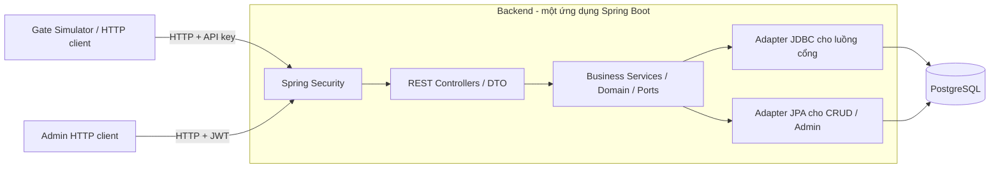

## 1. Phạm vi và đặc tả

### 1.1. Giới thiệu dự án

Automated Parking System là hệ thống quản lý bãi đỗ xe tự động, nhằm giảm sự phụ thuộc vào nhân viên trong việc ghi nhận xe vào/ra, phân bổ chỗ đỗ và cập nhật trạng thái bãi xe.

Hệ thống sử dụng Gate Simulator để mô phỏng các sự kiện xe vào/ra thông qua REST API, đồng thời cho phép Admin theo dõi và quản lý hoạt động của bãi đỗ xe.

Chức năng chính

Check-in tự động: Tiếp nhận thông tin xe, kiểm tra điều kiện và phân bổ chỗ đỗ phù hợp.

Checkout tự động: Kết thúc phiên gửi xe và giải phóng chỗ đỗ.

Quản lý chỗ đỗ: Xem danh sách, trạng thái và lọc chỗ đỗ theo loại xe.

Quản lý bảo trì: Cho phép Admin bật/tắt trạng thái bảo trì đối với chỗ đỗ.

Quản lý phiên gửi xe: Theo dõi phiên đang hoạt động và tra cứu lịch sử gửi xe.

### 1.2. API và lỗi

Đặc tả chi tiết: [`openapi.yaml`](src/main/resources/static/openapi.yaml). 8 thao tác tương ứng UC01–UC07:

| Ca sử dụng | Phương thức và đường dẫn | Xác thực | Thành công |
| --- | --- | --- | --- |
| UC01: đăng nhập | `POST /api/v1/auth/login` | Không yêu cầu | `200`: `accessToken`, `tokenType`, `expiresIn` khi tài khoản tồn tại, đang hoạt động và mật khẩu đúng; sai thông tin trả `401 INVALID_CREDENTIALS` |
| UC02, UC07: xe vào/gửi lại | `POST /api/v1/gates/entry` | API key | `201`: `status=ACCEPTED`, `sessionId`, `assignedSpot` |
| UC03, UC07: xe ra/gửi lại | `POST /api/v1/gates/exit` | API key | `200`: `status=ACCEPTED`, `sessionId`, `releasedSpot` |
| UC04: xem chỗ | `GET /api/v1/parking-spots` | JWT ADMIN | `200`: danh sách và phân trang |
| UC05: bật bảo trì | `POST /api/v1/parking-spots/{id}/maintenance` | JWT ADMIN | `201`: chỗ sau cập nhật |
| UC05: kết thúc bảo trì | `DELETE /api/v1/parking-spots/{id}/maintenance` | JWT ADMIN | `204`, không có body |
| UC06: tra cứu phiên | `GET /api/v1/parking-sessions` | JWT ADMIN | `200`: danh sách hiện tại/lịch sử và phân trang |
| UC06: chi tiết phiên | `GET /api/v1/parking-sessions/{id}` | JWT ADMIN | `200`: phiên theo ID |

Gate bắt buộc `eventId`, `gateId` (mỗi trường tối đa 64 ký tự) và `licensePlate`; ENTRY thêm `vehicleType`, EXIT không có trường này.

```json
{
  "eventId": "evt-entry-001",
  "gateId": "IN-01",
  "licensePlate": "29A-12345",
  "vehicleType": "MOTORBIKE"
}
```

| Danh sách | Bộ lọc | Sắp xếp |
| --- | --- | --- |
| Chỗ | `status`, `vehicleType`, `inMaintenance` | `code ASC` |
| Phiên | `status`, `licensePlate`, `from`, `to` | `checkInAt DESC`, rồi `id DESC` |

`page >= 0`, mặc định 0; `size` 1–100, mặc định 20. Phản hồi gồm `items` và `page: {page, size, totalElements, totalPages}`. Biển số tìm theo chuỗi chứa sau chuẩn hóa; `from`/`to` lọc thời điểm vào, gồm hai đầu mút, `from <= to`.

| HTTP | Mã lỗi | Điều kiện |
| --- | --- | --- |
| `400` | `VALIDATION_ERROR` | Đầu vào không hợp lệ |
| `401` / `403` | `INVALID_CREDENTIALS`, `UNAUTHORIZED` / `FORBIDDEN` | Sai đăng nhập, thiếu/sai xác thực hoặc thiếu quyền |
| `404` | `SPOT_NOT_FOUND`, `SESSION_NOT_FOUND` | Không có đối tượng |
| `409` | `VEHICLE_ALREADY_PARKED`, `NO_AVAILABLE_SPOT` | Xe đã trong bãi hoặc hết chỗ đúng loại |
| `409` | `NO_ACTIVE_SESSION`, `EVENT_ID_REUSED` | Không có phiên để cho xe ra hoặc ID cũ với dữ liệu khác |
| `409` | `SPOT_OCCUPIED`, `ALREADY_IN_MAINTENANCE` | Bật bảo trì chỗ có xe hoặc đã bảo trì |
| `500` / `503` | `INTERNAL_ERROR` / `SERVICE_UNAVAILABLE` | Lỗi kỹ thuật / tạm không khả dụng theo OpenAPI |

Lỗi có dạng `{"error":{"code":"...","message":"..."}}`. Chưa có ánh xạ riêng sang `503`; lỗi chưa xử lý thường trả `500`. Pha 2 cần chuẩn hóa lỗi xác thực/phân quyền, đọc JSON và chuyển đổi tham số truy vấn theo đặc tả.

### 1.3. Công nghệ

- Spring Boot 3.5
- Maven 3.9+
- PostgreSQL 17, Flyway, Spring Data JPA và JDBC
- Spring Security, JWT HMAC-SHA256 và BCrypt
- Docker Compose

## 2. Kiến trúc và dữ liệu

### 2.1. Phân lớp và mã nguồn

Kiến trúc layer, dùng ports/adapters để đảo chiều phụ thuộc; một JAR, một tiến trình Spring Boot. PostgreSQL lưu dữ liệu và quản lý khóa dùng chung.



Các package dưới `src/main/java/com/ktpm/parking/`:

| Package | Trách nhiệm/thành phần |
| --- | --- |
| `api/controller`, `dto`, `error` | HTTP, validation, DTO → đầu vào nghiệp vụ, ánh xạ kết quả/lỗi |
| `business/domain` | Chỗ, phiên, sự kiện cổng, tài khoản, enum trạng thái |
| `business/service` | `CheckInService`, `CheckOutService`, `ParkingSpotAdminService`, `ParkingSessionAdminService`, `AuthService` |
| `business/repository`, `port` | Interface CRUD, workflow khóa/cập nhật có điều kiện, `ParkingUnitOfWork`, kiểm tra mật khẩu/phát token |
| `business/support` | Chuẩn hóa biển số, băm yêu cầu |
| `infrastructure/persistence` | JPA entity/mapper/CRUD; `JdbcTemplate` viết SQL trực tiếp cho Gate; `ParkingSpotRepositoryAdapter`, `ParkingSpotWorkflowRepositoryAdapter`, `ParkingSessionWorkflowRepositoryAdapter` |
| `infrastructure/transaction` | `PersistentParkingService` gắn `gateId` từng lần gọi; `SpringParkingUnitOfWork` quản lý giao dịch |
| `infrastructure/security` | API key cấp `ROLE_GATE`; JWT HS256 đọc `roles`; BCrypt; không lưu phiên HTTP (stateless) |
| `infrastructure/config`, `bootstrap` | Wiring service/adapter, `Clock.systemUTC()`, Swagger UI, tạo Admin từ biến môi trường |

Tệp cấu hình: `src/main/resources/application.yml`; schema: `src/main/resources/db/migration/`; API: `src/main/resources/static/openapi.yaml`; test: `src/test/`; build: `pom.xml`, `Dockerfile`; triển khai: `docker-compose.yml`, `.env.example`; CI: `.github/workflows/ci.yml`; bàn giao/kết quả tải: `docs/`.

### 2.2. Giao dịch và xử lý đồng thời

ENTRY: Security/Controller kiểm tra API key/DTO, tạo `CheckInCommand` → Business chuẩn hóa/kiểm tra/băm → mở giao dịch, tạo hoặc nhận diện sự kiện cũ → khóa biển số, kiểm tra xe chưa có ACTIVE → `ORDER BY code ASC LIMIT 1 FOR UPDATE` chọn chỗ → chuyển chỗ sang `OCCUPIED`, tạo phiên `ACTIVE`, lưu kết quả và commit. Mã và dữ liệu phản hồi theo mục 1.2. Kết quả từ chối nghiệp vụ cũng được lưu và commit để lần gửi lại nhận cùng phản hồi.

EXIT: nhận diện sự kiện → khóa biển số → `FOR UPDATE OF s` khóa phiên ACTIVE → ghi thời gian ra, hoàn tất phiên, giải phóng chỗ, lưu kết quả và commit. Quy tắc gửi lại/rollback ở mục 1.3.

- `SpringParkingUnitOfWork`: `REQUIRED`, mức cô lập `READ_COMMITTED`; workflow adapter yêu cầu giao dịch hiện hữu (`MANDATORY`). Không tham gia giao dịch bên ngoài chỉ đọc hoặc có mức cô lập được cấu hình khác `READ_COMMITTED`.
- Khóa theo biển số (advisory lock) dùng `pg_advisory_xact_lock` theo `licensePlateKey` để tuần tự hóa ENTRY/EXIT cùng xe, cả khi chưa có dòng phiên; dùng chung giữa các backend kết nối cùng DB.
- Khóa dòng (row lock) bảo vệ dữ liệu chỗ đỗ và phiên gửi xe; `markOccupied`, `markAvailable`, `complete` cập nhật có điều kiện, phải đúng một dòng.
- Event mới dùng `INSERT ... ON CONFLICT DO NOTHING`; ID trùng chờ giao dịch sở hữu hoàn tất rồi đọc bằng statement mới `SELECT ... FOR UPDATE`.
- Cấp chỗ chờ khóa, không dùng `SKIP LOCKED`; bỏ qua chỗ bị khóa có thể đổi hành vi khi giao dịch khác chưa hoàn tất, cần đo trước khi thay.
- Chỉ mục duy nhất có điều kiện (partial unique index) ngăn một xe hoặc một chỗ có nhiều phiên ACTIVE, nhưng chưa bảo đảm mọi quy tắc nhất quán giữa các bảng. Bảo trì đang `findById` rồi `save` dữ liệu đã đọc, chưa có khóa/giao dịch thống nhất; có thể ghi đè trạng thái khi chạy đồng thời với Gate.

### 2.3. Schema và migration

| Bảng | Trường và ràng buộc |
| --- | --- |
| `parking_spots` | `id bigint PK`, `code varchar UK`, `vehicle_type varchar`, `occupancy_status varchar`, `in_maintenance boolean` |
| `parking_sessions` | `id bigint PK`, `license_plate varchar`, `license_plate_key varchar`, `parking_spot_id bigint FK` → `parking_spots` (một chỗ có nhiều phiên lịch sử), `vehicle_type varchar`, `check_in_time timestamptz`, `check_out_time timestamptz`, `status varchar` |
| `gate_events` | `event_id varchar PK`, `gate_id varchar`, `event_type varchar`, `request_hash varchar`, `processing_status varchar`, `response_data jsonb`, `created_at timestamptz`; không FK đến phiên; trạng thái `PROCESSING`, `SUCCEEDED`, `REJECTED`, lưu kết quả để truy vết/gửi lại |
| `admin_accounts` | `id bigint PK`, `username varchar`, `password_hash varchar`, `enabled boolean`; unique index trên `LOWER(username)`, mật khẩu BCrypt |

Migration trong [`db/migration`](src/main/resources/db/migration):

| Tệp | Thay đổi |
| --- | --- |
| `V1__create_parking_schema.sql` | Bốn bảng, FK, kiểm tra trạng thái/thời gian, index tra cứu và unique index phiên ACTIVE |
| `V2__seed_parking_spots.sql` | 20 chỗ MOTORBIKE `A01`–`A20`, 10 chỗ CAR `B01`–`B10`, trống và không bảo trì |
| `V3__add_license_plate_key.sql` | Backfill khóa biển số, `NOT NULL`/check constraint, unique index ACTIVE theo khóa chuẩn hóa, index lịch sử theo khóa/thời gian |

V3 giữ lịch sử; khóa cũ không hợp lệ hoặc ACTIVE trùng sau chuẩn hóa làm migration thất bại và rollback: rà soát dữ liệu trước khi chạy lại. Giữ V1–V3; thay schema bằng migration mới từ V4.

## 3. Chạy bằng Docker Compose

### 3.1. Chuẩn bị và khởi động

Stack: Java 21, Spring Boot `3.5.16`, Maven trong image; PostgreSQL 17, Flyway, Spring Data JPA/Hibernate/JDBC; Spring MVC, Spring Security/OAuth2 Resource Server JWT, Bean Validation; springdoc `2.8.17`, Actuator health/info. Cấu hình `ddl-auto=validate`, `open-in-view=false`.

Cần Docker Desktop/Docker Engine đang hoạt động, Compose v2, mạng để tải image/thư viện lần đầu và cổng `8080`, `5432` trống. Java/Maven/PostgreSQL nằm trong image. Windows dùng Linux containers. Mở PowerShell tại thư mục chứa `docker-compose.yml`:

```powershell
docker info
docker compose version
```

Nếu engine chưa sẵn sàng, mở Docker Desktop và đợi. Tạo `.env` nếu chưa có:

```powershell
if (-not (Test-Path -LiteralPath .env)) {
    Copy-Item -LiteralPath .env.example -Destination .env
}
```

Bash: `cp .env.example .env` chỉ khi chưa có tệp. Thay mọi `replace-with-...` theo mục 3.2, cấu hình cả tài khoản/mật khẩu Admin để thử quản trị. Compose đọc `.env` trực tiếp.

```powershell
docker compose config --quiet
docker compose up -d --build
```

Compose tạo image backend, chờ PostgreSQL qua `pg_isready`; backend chạy Flyway, Hibernate kiểm tra schema rồi bootstrap Admin nếu được cấu hình. Lần tạo image đầu tiên có thể mất thời gian tải các thành phần cần thiết.

```powershell
docker compose ps
docker compose logs --tail=100 backend
```

Đợi `backend` và `database` đều `healthy`, rồi thử API theo mục 4.2:

| Truy cập từ máy Docker | Địa chỉ |
| --- | --- |
| Health | <http://localhost:8080/actuator/health>, có `status: UP` |
| Swagger UI | <http://localhost:8080/swagger-ui.html> |
| OpenAPI | <http://localhost:8080/openapi.yaml> |
| Backend / PostgreSQL | `http://localhost:8080` / `localhost:5432` |
| Trong mạng Compose | `backend:8080` / `database:5432` |

### 3.2. Biến môi trường và dữ liệu

| Biến | Cấu hình |
| --- | --- |
| `POSTGRES_DB` | Bắt buộc; mẫu `automated_parking` |
| `POSTGRES_USER` | Bắt buộc; mẫu `parking` |
| `POSTGRES_PASSWORD` | Bắt buộc, thay mật khẩu mẫu |
| `GATE_API_KEY` | Bắt buộc, ít nhất 16 ký tự; dùng cho `X-Gate-Api-Key` |
| `JWT_SECRET` | Bắt buộc, ít nhất 32 ký tự; ký/xác minh HS256 |
| `JWT_EXPIRATION_SECONDS` | Thời hạn token tính bằng giây; mặc định `3600`, tối thiểu 1 |
| `ADMIN_BOOTSTRAP_USERNAME` | Đi cùng mật khẩu; mẫu `admin` |
| `ADMIN_BOOTSTRAP_PASSWORD` | Đi cùng username, thay giá trị mẫu; lưu BCrypt |

Compose đặt `DB_URL=jdbc:postgresql://database:5432/${POSTGRES_DB}`, `DB_USERNAME` từ `POSTGRES_USER`, `DB_PASSWORD` từ `POSTGRES_PASSWORD`. Backend kết nối dịch vụ `database`; volume `postgres-data` giữ dữ liệu khi tạo lại container.

Hai biến Admin cùng có giá trị hoặc cùng trống (không tạo Admin). Bootstrap không ghi đè tài khoản; đổi mật khẩu trong `.env` không đổi tài khoản cũ. Đổi `POSTGRES_*` không cập nhật DB/tài khoản đã khởi tạo trong volume. Không đưa `.env`/secret lên Git; `.dockerignore` loại tệp khỏi dữ liệu tạo image, Compose truyền cấu hình lúc chạy.

### 3.3. Vận hành và lỗi thường gặp

| Công việc | Lệnh |
| --- | --- |
| Log PostgreSQL | `docker compose logs --tail=100 database` |
| Theo dõi log backend | `docker compose logs -f backend`; `Ctrl+C` kết thúc xem |
| Tạm dừng, giữ container/dữ liệu | `docker compose stop` |
| Chạy lại container đã dừng | `docker compose start` |
| Gỡ container, giữ volume | `docker compose down` |
| Áp dụng `.env` mới | `docker compose up -d` |
| Sửa mã nguồn | Chạy lại lệnh tạo image/khởi động ở mục 3.1 |

`docker compose down -v` xóa volume và toàn bộ dữ liệu PostgreSQL của môi trường Compose. Chỉ dùng khi chấp nhận khởi tạo lại dữ liệu thử nghiệm.

| Lỗi | Xử lý |
| --- | --- |
| Không kết nối engine | Mở Docker Desktop, đợi engine và kiểm tra bằng lệnh ở mục 3.1 |
| Thiếu biến/cấu hình bảo mật bị từ chối | Kiểm tra `.env`, thay giá trị mẫu/đủ độ dài; kiểm tra lại cấu hình ở mục 3.1 |
| Cổng bị chiếm | Giải phóng cổng trước khi chạy lại |
| Dịch vụ chưa healthy | Xem log của dịch vụ tương ứng; kiểm tra lỗi kết nối, mật khẩu DB và Flyway. Với volume cũ, đối chiếu thông tin đã dùng lúc khởi tạo |
| Login lỗi sau đổi `.env` | Dùng thông tin tài khoản đã lưu trong cơ sở dữ liệu; chỉ tạo lại volume nếu chấp nhận xóa dữ liệu thử nghiệm |

[`Dockerfile`](Dockerfile) build nhiều giai đoạn: `maven:3.9.16-eclipse-temurin-21-alpine` đóng gói JAR, `eclipse-temurin:21-jre-alpine` chạy bằng user `parking` không có quyền root. Build dùng `-DskipTests`; kiểm tra test/CI trước bàn giao.

Compose hiện có một backend, một PostgreSQL; chưa cấu hình reverse proxy/TLS, cân bằng tải, sao chép DB, giới hạn CPU/RAM. Healthcheck gọi `/actuator/health`; `unhealthy` không tự restart container. Graceful shutdown chờ yêu cầu đang xử lý hoàn tất, tối đa 20 giây mỗi phase. Khi lên máy chủ, cấu hình secret/TLS/quyền truy cập DB/sao lưu-khôi phục và lưu tệp triển khai để tái lập.

## 4. Kiểm thử

### 4.1. Phát triển và CI

Để chạy kiểm thử trên máy, cần JDK 21+, Maven và Docker đang hoạt động để Testcontainers khởi tạo PostgreSQL thật:

```powershell
mvn --batch-mode clean verify
```

JUnit 5, Mockito, Spring Boot Test kiểm tra nghiệp vụ, chuẩn hóa/hash, controller/HTTP và bảo mật. Integration test `*IT` kiểm tra Flyway, persistence, giao dịch/rollback, khóa, unique constraint và khởi tạo ứng dụng; có tranh chấp chỗ/biển số/event ID và kiểm tra replay. Test bảo trì dùng SQL cập nhật có điều kiện trực tiếp, chưa chứng minh API bảo trì an toàn đồng thời.

Integration test tự bỏ qua nếu thiếu Docker: kiểm tra `target/surefire-reports`, `target/failsafe-reports`, bảo đảm test thực sự chạy. GitHub Actions chạy lệnh trên khi push `basic_version`/`main` và pull request; test chức năng không thay số liệu tải ở mục 5.

### 4.2. Thử API bằng Swagger UI

Sau mục 3.1, chuẩn bị API key và Admin trong `.env`:

1. Chọn **Authorize** → `GateApiKey`, nhập `GATE_API_KEY`.
2. ENTRY: chọn **Try it out**, dùng JSON ở mục 1.2 với eventId mới, biển số chưa ACTIVE và còn chỗ đúng loại. Kiểm tra mã/trường trả về trong bảng API.
3. Gửi lại nguyên ENTRY: cùng phiên/chỗ, header theo mục 1.3.
4. EXIT: eventId mới, gateId cổng ra, cùng biển số.
5. Login Admin, lấy `accessToken`; **Authorize** → `AdminBearer`, nhập token.
6. GET chỗ/phiên trả `200`; tra `sessionId` từ ENTRY, xác nhận COMPLETED sau EXIT.
7. Bật/kết thúc bảo trì một chỗ trống; lặp kết thúc để kiểm tra tính gửi lại. Thử các nhánh từ chối theo bảng lỗi mục 1.2.

## 5. Kết quả kiểm thử tải
### 5.2. Môi trường và số liệu Kaggle

| Runtime Kaggle | Giá trị |
| --- | --- |
| OS / Python | `Linux-6.18.55+-x86_64-with-glibc2.39` / `3.13.15` |
| CPU | Allocated CPU: 4; Logical CPU reported: 4; Physical CPU reported: 2 |
| RAM total / RAM available | 31,35 GB / 30,04 GB |
| Working disk total / Working disk free | 19,52 GB / 19,50 GB |


p50/p95/p99 tổng hợp có đơn vị ms; p95 là mốc khoảng 95% yêu cầu không vượt quá. Thông lượng làm tròn hai chữ số thập phân; nhấn mức tải để xem ảnh.

| Người dùng ảo | Tạo người dùng/giây | Thời lượng cấu hình | Tổng yêu cầu | Lượt lỗi | Yêu cầu/giây | p50 (ms) | p95 (ms) | p99 (ms) |
|---|---|---|---|---|---|---|---|---|
| [5](docs/load-testing/kaggle/images/image1.png) | 1 | 1 phút | 196 | 0 | 3,33 | 520 | 820 | 1.100 |
| [25](docs/load-testing/kaggle/images/image6.png) | 5 | 3 phút | 2.433 | 0 | 13,51 | 890 | 1.200 | 1.400 |
| [50](docs/load-testing/kaggle/images/image4.png) | 10 | 5 phút | 4.407 | 0 | 14,63 | 2.800 | 3.200 | 3.400 |
| [75](docs/load-testing/kaggle/images/image3.png) | 10 | 5 phút | 4.427 | 0 | 14,64 | 4.900 | 5.300 | 5.400 |
| [100](docs/load-testing/kaggle/images/image2.png) | 10 | 5 phút | 4.431 | 0 | 14,61 | 7.000 | 7.400 | 7.500 |
| [200](docs/load-testing/kaggle/images/image5.png) | 20 | 5 phút | 4.502 | 0 | 14,65 | 16.000 | 16.000 | 16.000 |
| [500](docs/load-testing/kaggle/images/image7.png) | 25 | 5 phút | 8.219 | 3.665 (44,59%) | 26,53 | 7.800 | 20.000 | 20.000 |


p95 từng API (ms), theo nhãn ảnh:

| Người dùng ảo | `GET /parking-spots` | `GET /parking-sessions` | `POST /auth/login` |
| --- | --- | --- | --- |
| [5](docs/load-testing/kaggle/images/image1.png) | 750 | 740 | 1.100 |
| [25](docs/load-testing/kaggle/images/image6.png) | 1.200 | 700 | 1.600 |
| [50](docs/load-testing/kaggle/images/image4.png) | 3.200 | 1.500 | 1.900 |
| [75](docs/load-testing/kaggle/images/image3.png) | 5.300 | 2.300 | 2.700 |
| [100](docs/load-testing/kaggle/images/image2.png) | 7.400 | 3.200 | 3.500 |
| [200](docs/load-testing/kaggle/images/image5.png) | 16.000 | 6.600 | 6.400 |

GET chỗ chiếm 67–72% tổng yêu cầu, ảnh hưởng lớn đến số liệu gộp. Số lượt login bằng số người dùng ảo.
Lỗi tại 500 người dùng:

| Nhãn yêu cầu trong báo cáo | HTTP 502 | Nhãn `HTTP 0` | Tổng lượt lỗi |
| --- | --- | --- | --- |
| `POST /auth/login` | 878 | 2 | 880 |
| `GET /parking-spots` | 1.880 | 40 | 1.920 |
| `GET /parking-sessions` | 858 | 7 | 865 |
| **Tổng** | **3.616** | **49** | **3.665** |

502 chiếm 98,66% số lượt lỗi, không phải tổng yêu cầu. `HTTP 0` là nhãn kịch bản, không phải HTTP chuẩn; cần log phân loại. Ghi chú nguồn nói backend không restart, health phục hồi; chưa có log/thời gian phục hồi để đối chiếu.


## 6. 1 số vấn đề hiện tại

| Vấn đề | Hướng cải tiến dự kiến |
|---|---|
| Throughput bão hòa khoảng 14,6 req/s | Xác định và xử lý điểm nghẽn tài nguyên dùng chung (CPU, database connection pool, worker threads). |
| `GET /parking-spots` phản hồi chậm | Tối ưu luồng đọc dữ liệu, truy vấn database, phân trang và cân nhắc Cache-Aside. |
| Latency tăng mạnh khi tăng Virtual Users | Giảm thời gian chờ tài nguyên, nghiên cứu Bulkhead Pattern. |
| Tỷ lệ lỗi cao ở mức 500 VU | Kiểm soát quá tải, giới hạn request đồng thời và cấu hình timeout phù hợp. |
| Khó thay đổi thuật toán phân bổ chỗ | Áp dụng Strategy Pattern để tách biệt các chiến lược phân bổ chỗ đỗ. |
| Sự kiện từ cổng bị gửi trùng | Cải thiện Reliability, cơ chế idempotency và khả năng phục hồi khi mất phản hồi. |
| Race Condition khi hai xe cùng tranh một chỗ | Sử dụng transaction, row-level locking, unique constraints và idempotency để đảm bảo tính nhất quán dữ liệu. |


## 7. Quy ước và tài liệu

- Cập nhật OpenAPI cùng thay đổi API; kiểm thử status/body/`X-Event-Replayed`.
- Nghiệp vụ/port trong `business`, framework/giao dịch/adapter trong `infrastructure`, controller HTTP/DTO.
- Không sửa migration đã chia sẻ; thêm migration mới, giữ tương thích dữ liệu, mô tả quay lại bản trước; test quy tắc mới/lỗi sửa, dùng PostgreSQL thật cho khóa/partial index/đồng thời.
- Phân biệt bản đã triển khai với đề xuất; công bố điều kiện đo và giới hạn kết luận.
