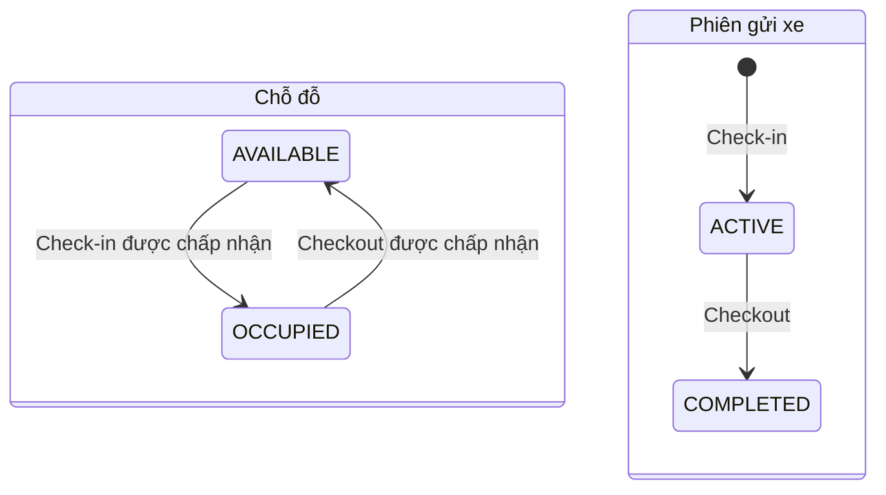
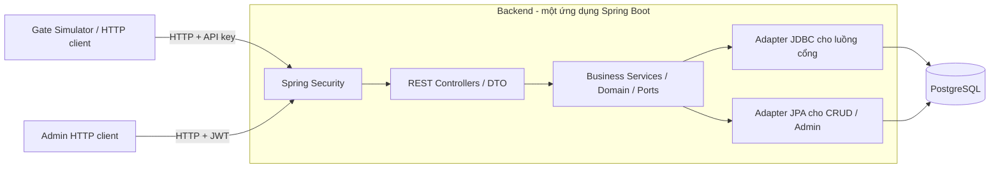
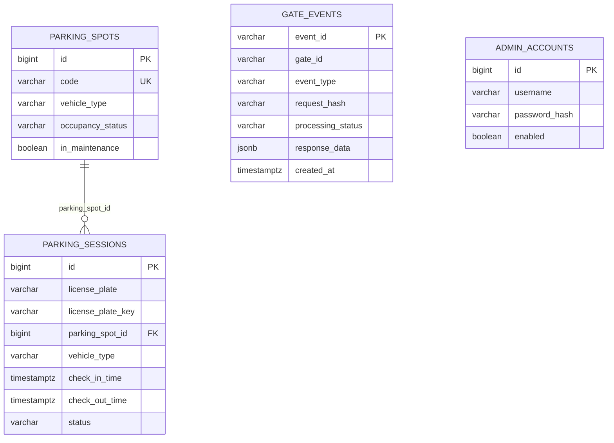

# Automated Parking System

Đây là hệ thống backend quản lý bãi đỗ xe tự động, được xây dựng bằng Java và Spring Boot. Hệ thống tiếp nhận sự kiện xe vào/ra thông qua HTTP, phân bổ chỗ đỗ, quản lý phiên gửi xe và cung cấp API cho quản trị viên.

Dự án được triển khai theo hai pha:

- **Pha 1 — hệ thống cơ sở:** xây dựng các chức năng quản lý bãi đỗ xe cơ bản. Kiến trúc, đặc tả và hướng dẫn chạy dưới đây mô tả mã nguồn hiện có.
- **Pha 2 — cải tiến thuộc tính chất lượng:** sử dụng phiên bản pha 1 làm cơ sở đối chiếu; xác định vấn đề, lựa chọn và triển khai giải pháp kiến trúc phù hợp; đánh giá kết quả trước và sau cải tiến trên **một cấu hình phần cứng duy nhất**. Các phương án ở phần 6 là những đề xuất để nhóm triển khai và kiểm chứng.

## 1. Phạm vi và đặc tả nghiệp vụ

### 1.1. Tác nhân và ranh giới hệ thống

| Tác nhân | Trách nhiệm | Cách truy cập |
| --- | --- | --- |
| Bộ mô phỏng cổng (Gate Simulator) | Gửi sự kiện xe vào/ra, nhận kết quả xử lý và gửi lại sự kiện khi cần | API dành cho cổng, sử dụng header HTTP `X-Gate-Api-Key` |
| Quản trị viên (Admin) | Đăng nhập, xem danh sách chỗ đỗ và lịch sử gửi xe, bật hoặc kết thúc chế độ bảo trì | API quản trị, JWT được gửi theo cơ chế Bearer và mang quyền `ADMIN` |

Pha 1 cung cấp **backend phục vụ một bãi đỗ xe**, hỗ trợ hai loại phương tiện `MOTORBIKE` và `CAR`. Hệ thống cung cấp API cho bộ mô phỏng cổng; nhóm có thể sử dụng Swagger UI hoặc công cụ gửi yêu cầu HTTP để tạo sự kiện. Hệ thống chưa có giao diện người dùng (frontend) phục vụ nghiệp vụ, phần cứng hoặc camera nhận diện biển số, tài khoản khách hàng/nhân viên, chức năng thanh toán, đặt chỗ trước hay quản lý nhiều bãi đỗ xe.

### 1.2. Các ca sử dụng

| Mã | Ca sử dụng | Điều kiện và kết quả |
| --- | --- | --- |
| UC01 | Đăng nhập quản trị viên | Tài khoản tồn tại, đang hoạt động và người dùng nhập đúng mật khẩu → được cấp JWT; thông tin đăng nhập không hợp lệ → `401 INVALID_CREDENTIALS`. Hệ thống không cung cấp API đăng ký. |
| UC02 | Xe vào bãi | Sự kiện hợp lệ, xe chưa có phiên `ACTIVE`, còn chỗ đỗ phù hợp và không trong chế độ bảo trì → tạo phiên `ACTIVE`, chuyển chỗ sang `OCCUPIED`, lưu kết quả xử lý sự kiện cổng. |
| UC03 | Xe ra bãi | Có phiên `ACTIVE` theo biển số → ghi thời gian ra, chuyển phiên sang `COMPLETED`, giải phóng chỗ về `AVAILABLE`, lưu kết quả xử lý sự kiện cổng. |
| UC04 | Xem chỗ đỗ | Quản trị viên lọc theo trạng thái sử dụng, loại xe và trạng thái bảo trì; nhận danh sách có phân trang. |
| UC05 | Quản lý bảo trì | Quản trị viên bật chế độ bảo trì cho chỗ đang trống; kết thúc bảo trì để chỗ có thể được phân bổ trở lại. Không xóa chỗ đỗ. |
| UC06 | Tra cứu phiên gửi xe | Quản trị viên xem các phiên đang hoạt động và lịch sử gửi xe, lọc theo biển số và thời gian vào hoặc xem chi tiết theo ID. |
| UC07 | Gửi lại sự kiện | Giữ nguyên `eventId` và dữ liệu nghiệp vụ → nhận lại kết quả đã lưu, không cập nhật lại dữ liệu. |

### 1.3. Quy tắc nghiệp vụ và trạng thái

1. **Biển số:** đầu vào có độ dài 4–20 ký tự. Biển số hiển thị được chuyển thành chữ hoa và gộp các khoảng trắng liên tiếp; khóa so sánh `licensePlateKey` được tạo bằng cách loại bỏ khoảng trắng và dấu `-`, rồi chuyển thành chữ hoa. Khóa chỉ chấp nhận 4–20 ký tự thuộc tập `A-Z`, `0-9`. Ví dụ: `29a-12345` và `29A 12345` có cùng khóa `29A12345`.
2. **Phân bổ chỗ:** chọn chỗ có trạng thái `AVAILABLE`, phù hợp với `vehicleType` và có `inMaintenance=false`, ưu tiên theo `code` tăng dần. Không cấp chỗ thuộc loại khác khi hết chỗ phù hợp.
3. **Phiên gửi xe:** mỗi biển số sau chuẩn hóa và mỗi chỗ đỗ có tối đa một phiên `ACTIVE`. Thao tác cho xe ra chỉ áp dụng đối với phiên đang hoạt động.
4. **Bảo trì:** `status` và `inMaintenance` là hai trường riêng. Chỗ trống đang bảo trì vẫn có `status=AVAILABLE` nhưng không được phân bổ. Yêu cầu bật bảo trì cho chỗ đang có xe trả về `SPOT_OCCUPIED`; bật bảo trì cho chỗ đã ở chế độ này trả về `ALREADY_IN_MAINTENANCE`. Yêu cầu kết thúc bảo trì vẫn trả về `204` nếu chỗ tồn tại, kể cả khi được gửi nhiều lần.
5. **Thời gian:** backend ghi nhận các mốc thời gian nghiệp vụ bằng `Clock` theo UTC; API sử dụng định dạng ISO 8601. Phiên `ACTIVE` chưa có thời điểm xe ra; phiên `COMPLETED` phải có thời điểm xe ra bằng hoặc muộn hơn thời điểm xe vào.
6. **Tính nhất quán:** mọi thay đổi về chỗ đỗ, phiên gửi xe và kết quả xử lý sự kiện cổng phải được ghi trong cùng một giao dịch (transaction). Nếu xảy ra lỗi kỹ thuật, toàn bộ thay đổi trong giao dịch được hoàn tác (rollback).



Các quy tắc trên là yêu cầu nghiệp vụ của hệ thống. Luồng xử lý tại cổng đã sử dụng giao dịch và cơ chế khóa dữ liệu; thao tác bảo trì vẫn có nguy cơ xảy ra xung đột khi thực hiện đồng thời với xe vào/ra. Vấn đề này được phân tích ở phần 5.

### 1.4. Đặc tả API

Chi tiết về yêu cầu và phản hồi của từng API được mô tả trong [`openapi.yaml`](src/main/resources/static/openapi.yaml). Bảng sau tóm tắt 8 thao tác nghiệp vụ:

| Phương thức HTTP | Đường dẫn API | Xác thực | Phản hồi khi thành công |
| --- | --- | --- | --- |
| `POST` | `/api/v1/auth/login` | Không yêu cầu | `200`, `accessToken`, `tokenType`, `expiresIn` |
| `POST` | `/api/v1/gates/entry` | `X-Gate-Api-Key` | `201`, `status=ACCEPTED`, `sessionId`, `assignedSpot` |
| `POST` | `/api/v1/gates/exit` | `X-Gate-Api-Key` | `200`, `status=ACCEPTED`, `sessionId`, `releasedSpot` |
| `GET` | `/api/v1/parking-spots` | JWT `ADMIN` | `200`, danh sách chỗ và thông tin phân trang |
| `POST` | `/api/v1/parking-spots/{id}/maintenance` | JWT `ADMIN` | `201`, chỗ đỗ sau khi bật bảo trì |
| `DELETE` | `/api/v1/parking-spots/{id}/maintenance` | JWT `ADMIN` | `204`, không có nội dung phản hồi |
| `GET` | `/api/v1/parking-sessions` | JWT `ADMIN` | `200`, danh sách phiên và thông tin phân trang |
| `GET` | `/api/v1/parking-sessions/{id}` | JWT `ADMIN` | `200`, chi tiết phiên |

**Dữ liệu sự kiện tại cổng:** `eventId` và `gateId` là các trường bắt buộc, mỗi trường dài tối đa 64 ký tự; `licensePlate` cũng là trường bắt buộc. Sự kiện ENTRY cần thêm `vehicleType`; sự kiện EXIT không có trường này.

```json
{
  "eventId": "evt-entry-001",
  "gateId": "IN-01",
  "licensePlate": "29A-12345",
  "vehicleType": "MOTORBIKE"
}
```

**Truy vấn danh sách:**

| API | Bộ lọc | Thứ tự kết quả |
| --- | --- | --- |
| Chỗ đỗ | `status`, `vehicleType`, `inMaintenance` | `code ASC` |
| Phiên gửi xe | `status`, `licensePlate`, `from`, `to` | `checkInAt DESC`, sau đó `id DESC` |

Cả hai API cho phép `page` từ 0 trở lên (mặc định 0) và `size` từ 1 đến 100 (mặc định 20). Phản hồi gồm danh sách `items` và thông tin phân trang `page: {page, size, totalElements, totalPages}`. Bộ lọc biển số hiện tìm các biển số **chứa chuỗi tìm kiếm sau khi chuẩn hóa**. `from`/`to` lọc theo thời điểm xe **vào**, tính cả hai thời điểm giới hạn và yêu cầu `from <= to`.

**Mã trạng thái HTTP và mã lỗi:**

| Mã trạng thái HTTP | Mã lỗi | Trường hợp phát sinh |
| --- | --- | --- |
| `400` | `VALIDATION_ERROR` | Dữ liệu đầu vào không hợp lệ |
| `401` / `403` | `INVALID_CREDENTIALS`, `UNAUTHORIZED` / `FORBIDDEN` | Sai thông tin đăng nhập, thiếu hoặc sai thông tin xác thực, không đủ quyền truy cập |
| `404` | `SPOT_NOT_FOUND`, `SESSION_NOT_FOUND` | Không tìm thấy đối tượng |
| `409` | `VEHICLE_ALREADY_PARKED`, `NO_AVAILABLE_SPOT` | Xe đã trong bãi hoặc hết chỗ phù hợp |
| `409` | `NO_ACTIVE_SESSION`, `EVENT_ID_REUSED` | Không có phiên đang hoạt động để cho xe ra hoặc dùng lại mã sự kiện với dữ liệu khác |
| `409` | `SPOT_OCCUPIED`, `ALREADY_IN_MAINTENANCE` | Không thể bật bảo trì |
| `500` / `503` | `INTERNAL_ERROR` / `SERVICE_UNAVAILABLE` | Lỗi kỹ thuật / dịch vụ tạm thời không khả dụng theo đặc tả OpenAPI |

Cấu trúc phản hồi lỗi được quy định là `{"error":{"code":"...","message":"..."}}`. Hiện chưa có cơ chế riêng để trả mã `503` cho các lỗi dịch vụ tạm thời; các lỗi chưa được xử lý riêng thường trả về mã `500`. Trong pha 2, cần kiểm tra và chuẩn hóa cách phản hồi đối với các lỗi xác thực, phân quyền, đọc dữ liệu JSON và chuyển đổi tham số truy vấn theo đặc tả API.

### 1.5. Gửi lại sự kiện và chống xử lý trùng

`eventId` là mã định danh duy nhất trên toàn hệ thống cổng, dùng chung cho ENTRY và EXIT. Backend sử dụng SHA-256 để băm dữ liệu nghiệp vụ gồm loại sự kiện, `gateId`, khóa biển số và loại xe đối với ENTRY.

- Cùng `eventId` và cùng dữ liệu nghiệp vụ sau chuẩn hóa: trả lại kết quả đã lưu, kể cả kết quả từ chối; giữ nguyên mã trạng thái HTTP, nội dung phản hồi và thêm header `X-Event-Replayed: true`.
- Cùng `eventId` nhưng khác cổng, loại sự kiện hoặc dữ liệu nghiệp vụ: trả `409 EVENT_ID_REUSED`, giữ nguyên kết quả xử lý sự kiện ban đầu.
- Sự kiện mới nhận header `X-Event-Replayed: false`. Với sự kiện từng bị từ chối do hết chỗ, hệ thống vẫn trả lại kết quả từ chối đã lưu, ngay cả khi bãi hiện đã có chỗ. Một lần gửi sự kiện mới cần sử dụng `eventId` mới.
- Khi hết thời gian chờ hoặc không nhận được phản hồi, bên gửi sử dụng lại **cùng `eventId` và dữ liệu nghiệp vụ** để xác định kết quả; có thể tăng dần khoảng chờ giữa các lần gửi lại và giới hạn số lần thử. Không tạo `eventId` mới chỉ vì chưa nhận được phản hồi.
- Khi giao dịch bị hoàn tác do lỗi kỹ thuật, kết quả sự kiện chưa được lưu; yêu cầu được gửi lại với cùng `eventId` có thể được xử lý lại.

## 2. Kiến trúc pha 1

### 2.1. Kiểu kiến trúc và triển khai

Hệ thống sử dụng **kiến trúc đơn khối phân lớp (layered monolith) kết hợp mô hình ports/adapters để đảo chiều phụ thuộc**. Toàn bộ backend được đóng gói thành một tệp JAR và chạy trong một tiến trình Spring Boot. PostgreSQL bảo đảm lưu trữ dữ liệu bền vững và quản lý các khóa dữ liệu dùng chung.



Quan hệ phụ thuộc giữa các lớp trong **mã nguồn** được thể hiện như sau:

```text
API ----------------> Business <---------------- Infrastructure
Controller, DTO       Domain, use case, ports     Spring, Security, JPA/JDBC,
HTTP/error mapping    repository interfaces      transaction, configuration
```

Lớp nghiệp vụ (`business`) định nghĩa các interface cần sử dụng, gọi là **port**. Lớp hạ tầng (`infrastructure`) cung cấp các lớp triển khai tương ứng, gọi là **adapter**; Spring liên kết các thành phần khi khởi động. Lớp nghiệp vụ hiện sử dụng Java thuần, không phụ thuộc Spring MVC, Spring Data, JPA hoặc Hibernate. Cách tổ chức này tạo thuận lợi cho việc kiểm thử nghiệp vụ độc lập và thay đổi cách truy cập hạ tầng mà không ảnh hưởng nhiều đến logic nghiệp vụ.

### 2.2. Trách nhiệm các thành phần

| Thành phần | Vai trò và lưu ý khi mở rộng |
| --- | --- |
| `api/controller`, `dto`, `error` | Tiếp nhận yêu cầu HTTP, kiểm tra tính hợp lệ của dữ liệu, chuyển DTO thành đối tượng đầu vào nghiệp vụ, ánh xạ kết quả/lỗi sang phản hồi. |
| `business/domain` | Mô hình chỗ đỗ, phiên gửi xe, sự kiện cổng, tài khoản và các kiểu liệt kê trạng thái. |
| `business/service` | `CheckInService`, `CheckOutService` xử lý xe vào/ra; `ParkingSpotAdminService`, `ParkingSessionAdminService` xử lý chức năng quản trị; `AuthService` xử lý đăng nhập. |
| `business/repository`, `port` | Các interface phục vụ truy cập dữ liệu, quản lý giao dịch (`ParkingUnitOfWork`), xác minh mật khẩu và phát hành token. Tách interface cho thao tác CRUD và cho luồng nghiệp vụ cần khóa/cập nhật có điều kiện. |
| `business/support` | Chuẩn hóa biển số và tính mã băm của dữ liệu yêu cầu để nhận diện sự kiện trùng. |
| `infrastructure/persistence` | Các lớp ánh xạ dữ liệu và Spring Data JPA cho thao tác CRUD; `JdbcTemplate` với câu lệnh PostgreSQL viết trực tiếp cho luồng xử lý tại cổng. |
| `infrastructure/transaction` | `PersistentParkingService` kết nối port với adapter, gắn `gateId` cho từng lần gọi; `SpringParkingUnitOfWork` quản lý giao dịch. |
| `infrastructure/security` | Bộ lọc API key cấp quyền `ROLE_GATE`; xác minh/phát hành JWT HS256 và đọc trường `roles`; băm mật khẩu quản trị viên bằng BCrypt. Hệ thống không lưu phiên đăng nhập HTTP trên máy chủ (stateless). |
| `infrastructure/config`, `bootstrap` | Cấu hình liên kết các service/adapter, `Clock.systemUTC()`, Swagger UI và khởi tạo tài khoản quản trị viên từ biến môi trường. |

### 2.3. Luồng xử lý xe vào/ra

**Xe vào bãi (ENTRY):**

1. Lớp bảo mật kiểm tra API key; controller kiểm tra dữ liệu đầu vào và tạo `CheckInCommand`.
2. Lớp nghiệp vụ chuẩn hóa biển số, kiểm tra tính hợp lệ và tính mã băm của dữ liệu yêu cầu.
3. Bắt đầu giao dịch; tạo sự kiện cổng mới hoặc đọc sự kiện đã có để trả lại kết quả trước đó, hoặc từ chối trường hợp `eventId` đã được sử dụng với dữ liệu khác.
4. Sử dụng khóa theo biển số (advisory lock); kiểm tra xe chưa có phiên `ACTIVE`.
5. Chọn và khóa chỗ phù hợp bằng `ORDER BY code ASC LIMIT 1 FOR UPDATE`.
6. Chuyển chỗ sang `OCCUPIED`, tạo phiên `ACTIVE`, lưu kết quả xử lý sự kiện cổng rồi xác nhận giao dịch (commit).
7. Controller trả về `201` kèm ID phiên và mã chỗ đỗ. Nếu vi phạm quy tắc nghiệp vụ trong quá trình xử lý, hệ thống lưu kết quả từ chối rồi trả về `409`.

**Xe ra khỏi bãi (EXIT):** xác thực và nhận diện sự kiện tương tự ENTRY → khóa theo biển số → truy vấn và khóa phiên `ACTIVE` bằng `FOR UPDATE OF s` → hoàn tất phiên, giải phóng chỗ → lưu kết quả → xác nhận giao dịch → trả `200`. Nếu không có phiên đang hoạt động, hệ thống lưu kết quả từ chối với mã `NO_ACTIVE_SESSION` và trả `409`.

Khi nhận lại sự kiện đã xử lý, hệ thống trả kết quả đã lưu và không cập nhật lại phiên hoặc chỗ đỗ. Kết quả từ chối do vi phạm quy tắc nghiệp vụ cũng được lưu để các lần gửi lại nhận cùng phản hồi. Nếu xảy ra ngoại lệ kỹ thuật, giao dịch sẽ được hoàn tác.

### 2.4. Quản lý giao dịch và xử lý đồng thời

- `SpringParkingUnitOfWork` quản lý giao dịch theo cơ chế `REQUIRED`, với mức cô lập `READ_COMMITTED`. Các adapter phục vụ luồng vào/ra chỉ hoạt động trong một giao dịch đã được mở (`MANDATORY`). Luồng này không tham gia giao dịch bên ngoài có chế độ chỉ đọc hoặc mức cô lập được cấu hình khác `READ_COMMITTED`.
- `pg_advisory_xact_lock` theo `licensePlateKey` tuần tự hóa ENTRY/EXIT của cùng xe, kể cả khi chưa có dòng phiên để khóa. Khóa tại PostgreSQL được dùng chung giữa các tiến trình backend kết nối cùng cơ sở dữ liệu.
- Khóa dòng (row lock) bảo vệ dữ liệu chỗ đỗ và phiên gửi xe; `markOccupied`, `markAvailable`, `complete` thực hiện cập nhật có điều kiện theo trạng thái và yêu cầu cập nhật đúng một dòng.
- Sự kiện mới được ghi bằng `INSERT ... ON CONFLICT DO NOTHING`. Yêu cầu trùng ID chờ giao dịch đang xử lý sự kiện đó hoàn tất, sau đó đọc kết quả bằng một câu lệnh mới với `SELECT ... FOR UPDATE`.
- Cơ chế cấp chỗ hiện tại **chờ khóa được giải phóng**, không dùng `SKIP LOCKED`. Cần đo mức độ tranh chấp trước khi thay đổi cơ chế này; việc bỏ qua chỗ đang bị khóa có thể làm thay đổi hành vi hệ thống khi giao dịch khác chưa hoàn tất.
- Chỉ mục duy nhất có điều kiện (partial unique index) ngăn một xe hoặc một chỗ có nhiều phiên `ACTIVE`. Cơ chế này chưa bảo đảm toàn bộ quy tắc nhất quán giữa các bảng, chẳng hạn khi thao tác bảo trì ghi đè trạng thái chỗ bằng dữ liệu đã đọc trước đó.

### 2.5. Mô hình dữ liệu



`gate_events` lưu kết quả xử lý để phục vụ truy vết và trả lại kết quả khi sự kiện được gửi lại, với các trạng thái `PROCESSING`, `SUCCEEDED`, `REJECTED`; bảng này không có khóa ngoại đến phiên gửi xe. `response_data` lưu kết quả nghiệp vụ dưới dạng JSONB. `admin_accounts` có chỉ mục duy nhất trên `LOWER(username)` và lưu mật khẩu đã băm bằng BCrypt.

Các tệp cập nhật cấu trúc cơ sở dữ liệu (migration) nằm trong [`db/migration`](src/main/resources/db/migration):

| Tệp migration | Nội dung |
| --- | --- |
| `V1__create_parking_schema.sql` | Tạo bốn bảng, khóa ngoại, ràng buộc kiểm tra trạng thái/thời gian, chỉ mục tra cứu và chỉ mục duy nhất cho phiên đang hoạt động. |
| `V2__seed_parking_spots.sql` | Khởi tạo 20 chỗ xe máy `A01`–`A20`, 10 chỗ ô tô `B01`–`B10`, ban đầu trống và không bảo trì. |
| `V3__add_license_plate_key.sql` | Bổ sung khóa biển số cho dữ liệu hiện có, thêm `NOT NULL` và ràng buộc kiểm tra; chuyển chỉ mục duy nhất của phiên `ACTIVE` sang khóa biển số chuẩn hóa, thêm chỉ mục tra cứu lịch sử theo khóa và thời gian. |

Bản cập nhật V3 giữ nguyên lịch sử các phiên gửi xe. Dữ liệu cũ có khóa không hợp lệ hoặc phiên `ACTIVE` trùng khóa sau chuẩn hóa sẽ làm quá trình cập nhật thất bại và hoàn tác; cần rà soát dữ liệu trước khi chạy lại. Các thay đổi cấu trúc cơ sở dữ liệu tiếp theo phải được thực hiện bằng migration mới, bắt đầu từ **V4**, đồng thời giữ nguyên các migration V1–V3.

## 3. Công nghệ, biên dịch và triển khai

### 3.1. Công nghệ sử dụng và cấu trúc mã nguồn

| Nhóm | Công nghệ/cấu hình hiện có |
| --- | --- |
| Môi trường chạy và công cụ biên dịch | Java 21, Spring Boot `3.5.16`, khuyến nghị Maven 3.9 trở lên |
| HTTP và bảo mật | Spring MVC, Bean Validation, Spring Security, OAuth2 Resource Server JWT, HS256, BCrypt |
| Lưu trữ | PostgreSQL 17, Spring Data JPA/Hibernate, JDBC, Flyway; `ddl-auto=validate`, `open-in-view=false` |
| Tài liệu/vận hành | OpenAPI tĩnh, springdoc `2.8.17`, Actuator health/info |
| Kiểm thử | JUnit 5, Mockito, Spring Boot Test, Testcontainers PostgreSQL |
| Đóng gói và tích hợp liên tục (CI) | Tạo Docker image theo nhiều giai đoạn, Docker Compose, GitHub Actions |

```text
src/main/java/com/ktpm/parking/
  api/                    REST controller, DTO, ánh xạ lỗi
  business/               Domain, service, port, repository, support
  infrastructure/         Persistence, transaction, security, config, bootstrap
src/main/resources/
  application.yml         Cấu hình ứng dụng
  db/migration/           Flyway migrations
  static/openapi.yaml     Đặc tả API và nguồn cho Swagger UI
src/test/                 Kiểm thử đơn vị, controller, bảo mật và tích hợp
Dockerfile                Biên dịch JAR và tạo image chạy ứng dụng
docker-compose.yml        Backend, PostgreSQL và volume lưu dữ liệu
.env.example              Mẫu cấu hình môi trường
.github/workflows/ci.yml   Biên dịch và kiểm thử bằng Maven
docs/                     Tài liệu thiết kế/bàn giao trước đây
```

### 3.2. Chạy bằng Docker Compose

Yêu cầu: Docker Engine/Docker Desktop đang chạy, Docker Compose v2 và các cổng `8080`, `5432` chưa được sử dụng. Có thể biên dịch và chạy bằng Docker mà không cần cài Java/Maven trên máy chủ Docker.

Tại thư mục gốc dự án, tạo tệp cấu hình cho môi trường chạy:

```powershell
Copy-Item .env.example .env
```

Nếu dùng Bash, chạy `cp .env.example .env`. Chỉ tạo tệp khi chưa có `.env` riêng. Thay tất cả giá trị `replace-with-...` bằng các giá trị cấu hình của nhóm, sau đó chạy:

```powershell
docker compose up -d --build
docker compose ps
docker compose logs --tail=100 backend
```

Compose đọc `.env`, khởi động cơ sở dữ liệu, đợi `pg_isready` xác nhận sẵn sàng rồi khởi động backend. Backend dùng Flyway để cập nhật cơ sở dữ liệu, Hibernate để kiểm tra cấu trúc và tạo tài khoản quản trị viên ban đầu nếu được cấu hình. Chỉ thử API sau khi cả hai dịch vụ chuyển sang trạng thái `healthy`.

| Thành phần | Địa chỉ truy cập từ máy chạy Docker | Địa chỉ trong mạng Compose |
| --- | --- | --- |
| Backend | `http://localhost:8080` | `backend:8080` |
| PostgreSQL | `localhost:5432` | `database:5432` |

Backend trong container dùng JDBC URL trỏ đến **`database`**, không dùng `localhost`. Dữ liệu PostgreSQL được lưu trong volume tên `postgres-data` và vẫn tồn tại khi container được tạo lại.

Các địa chỉ kiểm tra:

- Swagger UI: <http://localhost:8080/swagger-ui.html>
- OpenAPI: <http://localhost:8080/openapi.yaml>
- Health: <http://localhost:8080/actuator/health>

Để dừng dịch vụ mà vẫn giữ dữ liệu, chạy `docker compose down`. Lệnh `docker compose down -v` **xóa volume và toàn bộ dữ liệu PostgreSQL trên môi trường đang chạy**; chỉ dùng khi chủ động muốn khởi tạo lại dữ liệu thử nghiệm.

### 3.3. Biến môi trường

| Biến | Giá trị/điều kiện | Ý nghĩa |
| --- | --- | --- |
| `POSTGRES_DB` | Bắt buộc cho Compose | Tên cơ sở dữ liệu |
| `POSTGRES_USER` | Bắt buộc cho Compose | Tên người dùng PostgreSQL |
| `POSTGRES_PASSWORD` | Bắt buộc cho Compose | Mật khẩu PostgreSQL |
| `DB_URL` | Ngoài Compose; mặc định `jdbc:postgresql://localhost:5432/automated_parking` | JDBC URL; Compose ánh xạ từ `POSTGRES_DB` |
| `DB_USERNAME` | Ngoài Compose; mặc định `parking` | Tên người dùng kết nối JDBC; Compose dùng `POSTGRES_USER` |
| `DB_PASSWORD` | Bắt buộc ngoài Compose | Mật khẩu JDBC; Compose dùng `POSTGRES_PASSWORD` |
| `GATE_API_KEY` | Bắt buộc, tối thiểu 16 ký tự | Khóa chung cho cổng mô phỏng |
| `JWT_SECRET` | Bắt buộc, tối thiểu 32 ký tự | Khóa ký/xác minh JWT HS256 |
| `JWT_EXPIRATION_SECONDS` | Mặc định `3600`, tối thiểu 1 | Thời hạn hiệu lực của token truy cập |
| `ADMIN_BOOTSTRAP_USERNAME` | Tùy chọn cùng mật khẩu | Tên đăng nhập quản trị viên ban đầu |
| `ADMIN_BOOTSTRAP_PASSWORD` | Tùy chọn cùng tên đăng nhập | Mật khẩu ban đầu, được băm BCrypt trước khi lưu |

Hai biến khởi tạo tài khoản quản trị viên phải cùng có giá trị hoặc cùng để trống. Khi cả hai để trống, hệ thống không tạo tài khoản quản trị viên; nếu cơ sở dữ liệu chưa có tài khoản, cần cấu hình cặp biến này để sử dụng API quản trị. Hệ thống bỏ qua tài khoản đã tồn tại, vì vậy, việc thay mật khẩu trong `.env` không làm thay đổi mật khẩu của tài khoản cũ. Việc thay đổi các biến `POSTGRES_*` cũng không tự động cập nhật cơ sở dữ liệu đã khởi tạo trong volume.

Không đưa tệp `.env` hoặc thông tin bí mật thực tế lên Git. `.dockerignore` loại `.env` khỏi dữ liệu gửi vào quá trình tạo image; Compose truyền cấu hình khi chạy container.

### 3.4. Chạy bằng Maven hoặc JAR

Yêu cầu có JDK 21 trở lên, Maven và PostgreSQL. Có thể chỉ khởi động cơ sở dữ liệu bằng `docker compose up -d database` sau khi tạo `.env`.

Spring Boot không tự đọc `.env`. Với định dạng `KEY=value` đơn giản của `.env.example`, nạp biến trong PowerShell như sau; giá trị được đọc nguyên văn, vì vậy không đặt giá trị trong cặp dấu nháy:

```powershell
Get-Content .env | ForEach-Object {
    $line = $_.Trim()
    if ($line -and -not $line.StartsWith('#')) {
        $name, $value = $line -split '=', 2
        Set-Item -Path "Env:$($name.Trim())" -Value $value
    }
}

$env:DB_URL = "jdbc:postgresql://localhost:5432/$env:POSTGRES_DB"
$env:DB_USERNAME = $env:POSTGRES_USER
$env:DB_PASSWORD = $env:POSTGRES_PASSWORD
mvn spring-boot:run
```

Biên dịch, kiểm thử và chạy tệp JAR trong cùng cửa sổ PowerShell đã nạp biến môi trường:

```powershell
mvn --batch-mode clean verify
java -jar target/automated-parking-system-0.0.1-SNAPSHOT.jar
```

### 3.5. Đóng gói và vận hành

[`Dockerfile`](Dockerfile) tạo image qua hai giai đoạn: biên dịch bằng `maven:3.9.16-eclipse-temurin-21-alpine` với lệnh `mvn -DskipTests package`; sau đó chép tệp JAR sang image dùng để chạy ứng dụng `eclipse-temurin:21-jre-alpine` và sử dụng tài khoản `parking` không có quyền root. **Quá trình tạo image bỏ qua kiểm thử**, nên cần chạy `mvn clean verify` riêng hoặc kiểm tra kết quả CI trước khi sử dụng image.

Compose hiện chạy **một container backend và một container PostgreSQL** trên một máy chủ Docker; chưa cấu hình reverse proxy/TLS, cân bằng tải, sao chép cơ sở dữ liệu hoặc giới hạn CPU/RAM cụ thể. Cơ chế kiểm tra tình trạng backend gọi `/actuator/health`; trạng thái `unhealthy` không tự động khiến container khởi động lại. Spring Boot đã bật cơ chế dừng mềm (graceful shutdown), cho phép các yêu cầu đang xử lý hoàn tất, với thời gian chờ tối đa 20 giây cho mỗi giai đoạn dừng.

Khi triển khai trên máy chủ, nhóm cần quản lý thông tin bí mật trong môi trường chạy, cấu hình TLS qua reverse proxy, giới hạn truy cập cổng PostgreSQL và thiết lập cách sao lưu/khôi phục dữ liệu phù hợp. Cần lưu các cấu hình bổ sung trong tệp triển khai để nhóm khác có thể tái lập môi trường.

## 4. Kiểm thử và kiểm tra sau triển khai

### 4.1. Bộ kiểm thử hiện có

```powershell
mvn --batch-mode clean verify
```

- Các bài kiểm thử đơn vị, controller và bảo mật xác minh quy tắc nghiệp vụ, chuẩn hóa biển số, mã băm yêu cầu, ánh xạ HTTP và xác thực.
- Các bài kiểm thử tích hợp `*IT` sử dụng PostgreSQL thực thông qua Testcontainers để kiểm tra Flyway, lưu trữ dữ liệu, giao dịch/hoàn tác, cơ chế khóa, ràng buộc duy nhất và khả năng khởi tạo ứng dụng.
- Kiểm thử tầng lưu trữ bao gồm tranh chấp chỗ đỗ, yêu cầu cùng biển số, cùng ID sự kiện, trả lại kết quả cũ và hoàn tác giao dịch. Kiểm thử bảo trì đồng thời hiện dùng **câu lệnh SQL cập nhật có điều kiện trực tiếp**, nên chưa chứng minh API bảo trì hiện tại an toàn khi chạy đồng thời.
- Các bài kiểm thử tích hợp được tự động bỏ qua khi Docker không khả dụng. Kiểm tra báo cáo trong `target/surefire-reports` và `target/failsafe-reports`; để xác minh cơ chế lưu trữ và khóa trên PostgreSQL, cần có Docker và bảo đảm các kiểm thử tích hợp thực sự được thực hiện.

CI chạy `mvn --batch-mode clean verify` khi có mã được đẩy lên nhánh `basic_version` hoặc `main`, cũng như khi có pull request. Kết quả kiểm thử chức năng chưa cung cấp số liệu kiểm thử tải hoặc bằng chứng về việc cải thiện hiệu năng.

### 4.2. Kiểm tra nhanh các luồng chính qua HTTP

Sau khi backend ở trạng thái `healthy`, dùng Swagger UI hoặc các lệnh PowerShell dưới đây. Các ví dụ giả định rằng biến môi trường từ `.env` đã được nạp như phần 3.4, tài khoản quản trị viên đã được khởi tạo hợp lệ, xe chưa ở trong bãi và vẫn còn chỗ đỗ xe máy.

```powershell
$baseUrl = 'http://localhost:8080'
$gateHeaders = @{ 'X-Gate-Api-Key' = $env:GATE_API_KEY }
$entryEventId = "entry-$([guid]::NewGuid().ToString('N'))"
$entryBody = @{
    eventId = $entryEventId
    gateId = 'IN-01'
    licensePlate = '29A-12345'
    vehicleType = 'MOTORBIKE'
} | ConvertTo-Json

# ENTRY thành công: 201; gửi lại cùng body: vẫn 201, header replay=true.
Invoke-WebRequest -UseBasicParsing -Method Post -Uri "$baseUrl/api/v1/gates/entry" `
    -Headers $gateHeaders -ContentType 'application/json' -Body $entryBody
Invoke-WebRequest -UseBasicParsing -Method Post -Uri "$baseUrl/api/v1/gates/entry" `
    -Headers $gateHeaders -ContentType 'application/json' -Body $entryBody

$exitBody = @{
    eventId = "exit-$([guid]::NewGuid().ToString('N'))"
    gateId = 'OUT-01'
    licensePlate = '29A-12345'
} | ConvertTo-Json
Invoke-RestMethod -Method Post -Uri "$baseUrl/api/v1/gates/exit" `
    -Headers $gateHeaders -ContentType 'application/json' -Body $exitBody

$loginBody = @{
    username = $env:ADMIN_BOOTSTRAP_USERNAME
    password = $env:ADMIN_BOOTSTRAP_PASSWORD
} | ConvertTo-Json
$login = Invoke-RestMethod -Method Post -Uri "$baseUrl/api/v1/auth/login" `
    -ContentType 'application/json' -Body $loginBody
$adminHeaders = @{ Authorization = "Bearer $($login.accessToken)" }
Invoke-RestMethod -Uri "$baseUrl/api/v1/parking-sessions?page=0&size=20" `
    -Headers $adminHeaders
```

Kiểm tra thêm: ID mới cho xe đã trong bãi nhận `VEHICLE_ALREADY_PARKED`; ID cũ với dữ liệu khác nhận `EVENT_ID_REUSED`; yêu cầu cho xe ra khi không có phiên đang hoạt động nhận `NO_ACTIVE_SESSION`. Thử bật chế độ bảo trì cho một chỗ trống bằng API quản trị, sau đó xác nhận cổng không phân bổ chỗ đó.

## 5. Đánh giá hệ thống cơ sở

Đánh giá này dựa trên mã nguồn và phạm vi kiểm thử hiện có. Dự án chưa có kịch bản kiểm thử tải và báo cáo hiệu năng của phiên bản cơ sở; các nhận định về khả năng đáp ứng tải là **giả thuyết cần đo kiểm**, chưa phải kết quả thực nghiệm.

| Thuộc tính chất lượng | Cơ sở hiện có | Hạn chế/vấn đề cần xác minh | Căn cứ trong mã nguồn |
| --- | --- | --- | --- |
| Tính đúng đắn, toàn vẹn dữ liệu | Luồng cổng có giao dịch, khóa theo biển số/khóa dòng, cập nhật có điều kiện và chỉ mục duy nhất có điều kiện | Thao tác bảo trì đọc bằng `findById` rồi lưu lại dữ liệu đã đọc bằng `save`, chưa có cơ chế giao dịch và khóa thống nhất cho toàn bộ thao tác; có thể ghi đè trạng thái chỗ khi xử lý đồng thời với luồng cổng | `ParkingSpotAdminService`, `ParkingSpotRepositoryAdapter`; đối chiếu luồng xử lý bằng JDBC |
| Hiệu năng tra cứu | API có bộ lọc và giới hạn kích thước trang | Hai service quản trị gọi `findAll()`, sau đó lọc, sắp xếp và phân trang trong bộ nhớ; chi phí tăng theo tổng số bản ghi | `ParkingSpotAdminService`, `ParkingSessionAdminService` |
| Hiệu năng ghi đồng thời | Khóa bảo vệ dữ liệu xe/chỗ và chống xử lý trùng | Cấp chỗ theo mã đầu tiên, chờ khóa dòng; có thể tăng thời gian chờ khóa khi nhiều cổng cùng vào | `ParkingSpotWorkflowRepositoryAdapter`, `ParkingSessionWorkflowRepositoryAdapter` |
| Khả năng sửa đổi/kiểm thử | Lớp nghiệp vụ dùng Java thuần, tách port và adapter | Ranh giới chức năng trong một dự án; cần đo tác động thay đổi và kiểm tra phụ thuộc khi mở rộng | Các package `api`, `business`, `infrastructure` và bộ kiểm thử |
| Bảo mật, nhất quán API | API key, JWT, BCrypt; API key của cổng không hợp lệ nhận phản hồi lỗi JSON | Các cổng sử dụng chung một khóa; chưa giới hạn tần suất yêu cầu; lỗi JWT/phân quyền và chuyển đổi dữ liệu JSON/tham số truy vấn chưa được xử lý thống nhất đầy đủ | `SecurityConfiguration`, `GateApiKeyAuthenticationFilter`, `GlobalExceptionHandler` |
| Tính sẵn sàng, khả năng phục hồi | Lưu trữ PostgreSQL, kiểm tra tình trạng dịch vụ, dừng ứng dụng có chờ xử lý | Chỉ có một backend và một cơ sở dữ liệu PostgreSQL, mỗi thành phần đều là một điểm lỗi đơn lẻ; chưa kiểm chứng chuyển đổi dự phòng hoặc sao lưu/khôi phục | `docker-compose.yml`, `application.yml` |
| Khả năng quan sát | API kiểm tra tình trạng dịch vụ và nhật ký lỗi kỹ thuật | Chưa cấu hình xuất số liệu cho Prometheus, theo dõi yêu cầu phân tán hoặc báo cáo độ trễ p95, thông lượng và thời gian chờ khóa | `application.yml`, `pom.xml` |

## 6. Định hướng cải tiến pha 2

### 6.1. Chọn kiến trúc theo bài toán và thuộc tính chất lượng

Mỗi nhóm chọn một bài toán cụ thể dựa trên kết quả đánh giá phiên bản cơ sở hoặc yêu cầu chất lượng của hệ thống. Kịch bản đánh giá cần nêu: nguồn phát sinh yêu cầu, loại yêu cầu, điều kiện tải hoặc lỗi, thành phần bị tác động, phản ứng mong đợi của hệ thống và chỉ số cần đo. Ví dụ: “Quản trị viên tra cứu lịch sử 100.000 phiên với 20 máy khách đồng thời; API trả đúng kết quả lọc và giảm độ trễ p95 ít nhất 30% so với phiên bản cơ sở trên máy H1”. Đây là **mục tiêu đề xuất**, cần xác định trước khi đo.

| Bài toán / thuộc tính ưu tiên | Kiến trúc hoặc giải pháp phù hợp | Cách triển khai từ pha 1 | Chi phí và cách đánh giá |
| --- | --- | --- | --- |
| Bảo trì và xe vào cùng cập nhật chỗ đỗ; toàn vẹn dữ liệu | Giữ kiến trúc đơn khối, thống nhất giao dịch và cơ chế xử lý đồng thời tại cơ sở dữ liệu | Thêm port bảo trì; adapter cập nhật có điều kiện hoặc khóa dòng rồi kiểm tra lại trong cùng giao dịch; chỉ sửa trường cần đổi và giữ các ràng buộc dữ liệu | Có thể tăng thời gian chờ khóa; đo số vi phạm quy tắc nhất quán dữ liệu, thời gian chờ khóa và p95. Ưu tiên xử lý trước khi tăng tải. |
| API quản trị chậm khi lịch sử tăng; hiệu năng/bộ nhớ | Kiến trúc đơn khối với luồng truy vấn riêng, tách xử lý đọc và ghi ở mức chức năng nghiệp vụ | Port truy vấn nhận bộ lọc và tham số trang; dùng JPA Specification hoặc SQL để lọc, sắp xếp, phân trang bằng `LIMIT/OFFSET` và đếm tại cơ sở dữ liệu; chỉ lấy trường cần thiết, kiểm tra kế hoạch truy vấn và chỉ mục | Việc bổ sung truy vấn/chỉ mục có thể làm tăng chi phí ghi và lưu trữ; giữ cách tìm biển số chứa chuỗi. Đo độ trễ p95, bộ nhớ tiến trình/vùng heap, số truy vấn và số dòng quét. |
| Một backend dừng làm gián đoạn dịch vụ; khả dụng tầng ứng dụng | Reverse proxy/bộ cân bằng tải phân phối yêu cầu đến nhiều tiến trình backend không lưu phiên đăng nhập, dùng chung PostgreSQL | Chạy hai tiến trình backend sau proxy, dùng chung khóa JWT/API key và cơ sở dữ liệu; định tuyến theo tình trạng dịch vụ, đặt thời gian chờ, ngừng nhận yêu cầu mới trước khi dừng; kiểm soát migration và việc khởi tạo tài khoản quản trị viên | Tăng chi phí vận hành; cơ sở dữ liệu vẫn là điểm lỗi đơn lẻ. Đo tỷ lệ lỗi và thời gian phục hồi khi dừng một backend, với cùng tổng tài nguyên CPU/RAM. |
| Tác vụ báo cáo/thông báo xử lý chậm; cách ly tác vụ và phục hồi | Kiến trúc hướng sự kiện cho tác vụ phụ: transactional outbox và tiến trình xử lý nền (worker), có thể thêm bộ trung chuyển thông điệp (broker) | Ghi sự kiện vào bảng outbox trong cùng giao dịch với phiên/chỗ; worker xử lý sau khi giao dịch được xác nhận, có gửi lại với khoảng chờ tăng dần và chống xử lý trùng; theo dõi công việc tồn đọng và lỗi | Kết quả tác vụ phụ có thể cập nhật chậm hơn giao dịch chính; cần quản lý sự kiện trùng và thứ tự xử lý. Đo độ trễ từ đầu đến cuối, công việc tồn đọng và tác vụ bị mất hoặc thực hiện trùng khi worker lỗi. |
| Chức năng mới làm thay đổi nhiều phần mã nguồn; khả năng sửa đổi | Kiến trúc đơn khối theo mô-đun (modular monolith), chia theo Gate, Admin, Auth và có interface rõ ràng | Tổ chức mô-đun/package theo chức năng, hạn chế truy cập nội bộ giữa các mô-đun, kiểm tra quan hệ phụ thuộc; giữ mô hình nghiệp vụ và port độc lập với framework | Cần tổ chức lại mã nguồn và cấu hình liên kết; sử dụng cùng một yêu cầu thay đổi để đo số mô-đun/tệp bị ảnh hưởng, lỗi hồi quy và thời gian thực hiện theo cùng quy trình. |
| Chống lạm dụng API và thống nhất phản hồi lỗi; bảo mật | Kiểm soát yêu cầu tại lớp tiếp nhận HTTP của ứng dụng đơn khối hoặc reverse proxy đã triển khai | Chuẩn hóa xử lý lỗi xác thực, từ chối truy cập và chuyển đổi dữ liệu; giới hạn tần suất yêu cầu, quản lý vòng đời khóa, không ghi thông tin bí mật vào nhật ký | Có thể chặn yêu cầu hợp lệ; đo tỷ lệ chặn đúng/sai, mã trạng thái/cấu trúc lỗi và mức tăng độ trễ p95. |

Với quy mô pha 1, nên bắt đầu bằng **giữ kiến trúc đơn khối, bảo đảm tính nhất quán khi bảo trì, đưa thao tác truy vấn xuống cơ sở dữ liệu và bổ sung công cụ theo dõi hệ thống**. Bổ sung bộ nhớ đệm, worker, broker hoặc nhiều tiến trình backend khi yêu cầu chất lượng và kết quả đo cho thấy nhu cầu. Kiến trúc vi dịch vụ (microservices) phù hợp khi cần triển khai hoặc mở rộng từng dịch vụ độc lập và đã xác định rõ phạm vi dữ liệu của từng dịch vụ; việc phân tán dữ liệu phiên/chỗ/sự kiện sẽ làm phức tạp cơ chế giao dịch hiện có.

### 6.2. Mô hình triển khai và phạm vi áp dụng

Các mô hình dưới đây là phương án đề xuất cho pha 2. Cấu hình triển khai hiện tại được mô tả ở phần 3.

```text
A. Tối ưu tra cứu và tính đúng đắn
Client --> Backend [Gate transaction | Admin DB query] --> PostgreSQL

B. Chịu lỗi một tiến trình backend
Client --> Reverse proxy --> Backend 1 --+
                         --> Backend 2 --+--> PostgreSQL chung

C. Cách ly tác vụ phụ
Client --> Backend --> PostgreSQL [Spot + Session + GateEvent + Outbox]
                              Outbox --> Worker --> Báo cáo / Thông báo
                                         |
                                  Broker nếu cần
```

Phương án A giữ nguyên đặc tả API. Với B, cần kiểm soát việc cập nhật cơ sở dữ liệu và khởi tạo tài khoản quản trị viên một lần trước khi chạy nhiều tiến trình; tổng số kết nối trong các nhóm kết nối (connection pool) phải phù hợp với khả năng của cơ sở dữ liệu. Với C, kết quả cho xe vào/ra vẫn được trả sau khi giao dịch đồng bộ hoàn tất; tác vụ phụ được xử lý sau đó. Nếu chuyển cả quyết định cho xe vào/ra sang xử lý bất đồng bộ, cần đặc tả lại API, trạng thái chờ và cách phía gửi lấy kết quả.

Nếu dùng bộ nhớ đệm cho dữ liệu thống kê, cần quy định thời gian lưu, cách làm mới hoặc loại bỏ dữ liệu cũ và mức độ trễ cập nhật có thể chấp nhận được. Quyết định cấp chỗ và ràng buộc phiên `ACTIVE` vẫn dựa vào giao dịch PostgreSQL.

### 6.3. Kế hoạch triển khai cho nhóm pha 2

1. **Xác lập phiên bản cơ sở:** ghi lại mã commit của pha 1, chạy kiểm thử và kiểm tra nhanh các luồng chính, lưu kết quả thực tế. Dùng dữ liệu thử nghiệm riêng và tạo bản sao có thể khôi phục.
2. **Xác định mục tiêu:** chọn thuộc tính chất lượng, kịch bản và ngưỡng đạt; phân biệt lỗi đã xác định với nguy cơ gây nghẽn cần được đo kiểm.
3. **Đo trước khi cải tiến:** bổ sung công cụ đo cần thiết, chạy phiên bản cơ sở trên H1 theo phần 6.4. Dùng cùng công cụ thu thập số liệu và cấu hình theo dõi cho phiên bản cơ sở và phiên bản cải tiến.
4. **Ghi lại quyết định kiến trúc:** mô tả phương án, lý do lựa chọn, các phương án thay thế và chi phí; chỉ rõ vấn đề và chỉ số đo tương ứng ở phần 5–6.1.
5. **Triển khai phương án cải tiến:** bổ sung port/adapter/mô-đun, migration mới và tệp Compose hoặc cấu hình ghi đè tương ứng; ghi lệnh biên dịch, chạy, kiểm tra tình trạng và cách quay về phiên bản trước đó. Đánh giá từng thay đổi riêng trước khi kết hợp.
6. **Kiểm chứng:** chạy kiểm thử hồi quy và kiểm thử cho vấn đề được sửa; đo lại với cùng kịch bản, dữ liệu và phần cứng, kiểm tra cả hiệu năng và các quy tắc nhất quán dữ liệu.
7. **Kết luận từ số liệu:** so sánh kết quả trước và sau cải tiến, giải thích lợi ích và chi phí. Phương án không đạt vẫn cần báo cáo nguyên nhân, không mặc định rằng kiến trúc phức tạp hơn sẽ tốt hơn.

Kết quả bàn giao pha 2 gồm mã nguồn chạy được, cấu hình triển khai cho từng phương án được chọn, tài liệu quyết định kiến trúc, kịch bản và bộ dữ liệu kiểm thử tải có thể chạy lại, dữ liệu đo gốc và báo cáo so sánh. Có thể dùng k6 hoặc JMeter; dự án hiện chưa có các kịch bản này.

### 6.4. Đánh giá trên cùng một cấu hình phần cứng

Chọn và cố định **một máy H1** làm môi trường thử nghiệm trước khi đo. Chạy phiên bản cơ sở và mọi phương án cải tiến trên chính máy đó, giữ nguyên CPU, RAM, ổ đĩa và giới hạn VM/WSL/Docker. Không xem việc nâng cấp cấu hình hoặc chuyển sang máy mạnh hơn là bằng chứng cải tiến kiến trúc.

Ghi lại thông số môi trường đo trên máy thực tế trước lần đo đầu:

| Thông tin cố định | Giá trị cần ghi |
| --- | --- |
| CPU | Mẫu CPU, số nhân/luồng, giới hạn CPU cấp cho VM/Docker |
| RAM | RAM vật lý, RAM cấp cho VM/Docker, swap |
| Lưu trữ | Loại ổ, vị trí volume PostgreSQL, dung lượng khả dụng |
| Nền tảng | Hệ điều hành, phiên bản nhân hệ điều hành/WSL nếu dùng, phiên bản Docker/Compose |
| Môi trường chạy | Phiên bản JDK/JVM, cấu hình bộ nhớ heap và thu gom rác (GC), phiên bản PostgreSQL và mã định danh image (digest), cấu hình cơ sở dữ liệu |
| Tài nguyên được cấp | Tổng CPU/RAM cho toàn bộ thành phần phục vụ ứng dụng, giới hạn từng container và tổng số kết nối trong các connection pool |
| Tạo tải và theo dõi | Công cụ và phiên bản, vị trí chạy, tài nguyên cố định dành cho từng công cụ |
| Dữ liệu/kịch bản | Dữ liệu khởi tạo/bản sao dữ liệu, số phiên/chỗ/sự kiện, giá trị khởi tạo bộ sinh số ngẫu nhiên, tỷ lệ loại xe, mức chiếm chỗ và lịch gửi yêu cầu |

Có thể đặt công cụ tạo tải và công cụ đo trên H1 với lượng tài nguyên dành riêng không đổi; theo dõi mức sử dụng để phân biệt giới hạn của công cụ tạo tải với giới hạn của backend. Khi thêm tiến trình backend, worker hoặc proxy, **giữ nguyên tổng tài nguyên được cấp và phân bổ lại cho các thành phần**, bao gồm thành phần mới; ghi rõ cách phân bổ. Giữ nguyên cấu hình môi trường chạy chung, chỉ thay các tham số thuộc giải pháp đang đánh giá và công bố rõ trong báo cáo.

Với phương án B, dừng container trên H1 chỉ chứng minh chịu lỗi **một tiến trình/container**; chưa chứng minh chịu lỗi toàn máy, mạng hoặc PostgreSQL.

### 6.5. Kịch bản và quy trình đo trước và sau cải tiến

Chọn kịch bản tương ứng với cải tiến. Hai phiên bản cần dùng cùng dữ liệu đầu vào, mức tải, thời gian chờ, chính sách gửi lại và cách tính các chỉ số.

| Kịch bản | Thiết kế phép thử | Chỉ số cần thu |
| --- | --- | --- |
| Tra cứu lịch sử lớn | Bộ dữ liệu cố định, ví dụ 100.000 phiên `COMPLETED`; truy vấn có/không lọc, trang đầu và các trang có số thứ tự lớn, 20 máy khách đồng thời | Độ trễ p50/p95/p99, yêu cầu/giây, tỷ lệ lỗi, CPU/RAM/GC, số truy vấn và kế hoạch thực thi truy vấn |
| Xe vào/ra ổn định | Mỗi máy khách gửi ENTRY → EXIT sau khi được chấp nhận; số xe đang đỗ không vượt sức chứa 20 xe máy/10 ô tô; sự kiện mới dùng ID mới | p95 của từng API, chu kỳ thành công/giây, số yêu cầu hết thời gian chờ hoặc nhận mã `5xx`, thời gian chờ khóa và mức sử dụng nhóm kết nối |
| Tranh chấp và gửi lại sự kiện | Cùng biển số nhưng khác ID; cùng ID và dữ liệu; trùng ID nhưng khác dữ liệu; nhiều xe cùng yêu cầu chỗ cuối; bảo trì đồng thời với xe vào | Số trường hợp trùng phiên `ACTIVE`, trạng thái chỗ sai, kết quả trả lại sai và thời gian chờ khóa |
| Chịu lỗi backend | Tạo tải cố định, dừng một backend tại cùng thời điểm trong kịch bản, gửi lại đúng ID sự kiện; áp dụng cho phiên bản cơ sở và B | Số yêu cầu gián đoạn, thời gian phục hồi, dữ liệu bị mất hoặc cập nhật trùng, p95 trước/trong/sau lỗi |
| Tác vụ phụ gặp lỗi | Với C, dừng worker hoặc dịch vụ nhận rồi khởi động lại, giữ tốc độ gửi sự kiện đã định | Độ trễ đầu-cuối, số công việc tồn đọng, thời gian xử lý hết hàng chờ, tác vụ bị mất hoặc thực hiện trùng và ảnh hưởng đến luồng cổng |

Quy trình cho mỗi mức tải:

1. Khôi phục cùng bản sao dữ liệu, xác nhận số bản ghi và trạng thái ban đầu. Dữ liệu lịch sử phải tuân thủ ràng buộc khóa ngoại, khóa biển số và thời gian.
2. Khởi động phương án cần đo, chờ trạng thái `healthy`, chạy tải để làm nóng hệ thống trong 60 giây, sau đó đo trong 180 giây. Nếu đánh giá khởi động nguội (cold start), thực hiện bằng kịch bản riêng.
3. Lặp ít nhất 3 lần cho mỗi phương án, khôi phục dữ liệu giữa các lần, chạy xen kẽ phiên bản cơ sở và bản cải tiến để giảm ảnh hưởng của thứ tự đo. Báo cáo trung vị, giá trị nhỏ nhất/lớn nhất và kết quả từng lần chạy.
4. Thu thập số liệu tải và tài nguyên theo cùng chu kỳ lấy mẫu; lưu mã commit, thông số môi trường H1, cấu hình triển khai, mã định danh image (digest), dữ liệu thử nghiệm, kịch bản đo, nhật ký và số liệu gốc.
5. Kiểm tra các quy tắc nhất quán dữ liệu và kết quả HTTP sau phép đo. Khi chủ động gây lỗi để thử khả năng phục hồi, ghi rõ thời điểm gây lỗi và tiêu chí xác định hệ thống đã phục hồi.

Dữ liệu ban đầu chỉ có 30 chỗ; gửi ENTRY liên tục mà không có EXIT sẽ chủ yếu kiểm tra trường hợp hết chỗ. Cần tách kịch bản bãi đầy khỏi phép đo thông lượng xử lý thành công. Thống kê riêng các phản hồi `409` dự kiến theo nghiệp vụ, yêu cầu hết thời gian chờ và phản hồi `5xx`; đối chiếu với kết quả mong đợi để phát hiện cả trường hợp chấp nhận sai và từ chối sai.

### 6.6. Báo cáo và tiêu chí chấp nhận

Mỗi cải tiến cần trình bày rõ mối liên hệ: **vấn đề → kết quả đánh giá ban đầu → mục tiêu → quyết định kiến trúc → kết quả sau cải tiến → chi phí và hạn chế**. Mục tiêu có thể là không vi phạm quy tắc nhất quán dữ liệu khi xử lý đồng thời, hoặc giảm độ trễ p95 của API tra cứu ít nhất 30% mà không tăng tỷ lệ lỗi kỹ thuật. Các tiêu chí phải được xác định trước phép đo; đây chưa phải kết quả đã đạt.

Mẫu kết quả, điền sau khi chạy thực tế trên H1:

| Chỉ số / kịch bản | Pha 1 — trước | Pha 2 — sau | Chênh lệch | Mục tiêu và kết luận |
| --- | --- | --- | --- | --- |
| p95 tra cứu, cùng dữ liệu và mức tải (ms) | Chưa đo | Chưa đo | — | Ngưỡng đã xác định; đạt/không đạt |
| ENTRY → EXIT hợp lệ (chu kỳ/s) | Chưa đo | Chưa đo | — | Cùng mức chiếm chỗ |
| Yêu cầu hết thời gian chờ hoặc nhận mã 5xx (%) | Chưa đo | Chưa đo | — | Tách lỗi nghiệp vụ dự kiến |
| CPU / RAM cực đại toàn hệ thống | Chưa đo | Chưa đo | — | Cùng tổng tài nguyên được cấp |
| Vi phạm nhất quán dữ liệu/trả lại sai kết quả (lần trên N lượt) | Chưa đo | Chưa đo | — | 0 lỗi quan sát được; ghi N |
| Phục hồi khi dừng một backend (s) | Chưa đo | Chưa đo | — | Kèm số yêu cầu gián đoạn |

Với chỉ số có giá trị thấp hơn là tốt hơn, tính tỷ lệ giảm bằng `(trước - sau) / trước × 100%`; với thông lượng, tính tỷ lệ tăng bằng `(sau - trước) / trước × 100%`. Nếu giá trị ban đầu bằng 0, báo cáo chênh lệch tuyệt đối. Nếu kết thúc phép thử mà hệ thống chưa phục hồi, ghi “chưa phục hồi trong khoảng đo”. Kết luận chỉ áp dụng cho mức tải, dữ liệu và loại lỗi đã kiểm thử.

Nếu phương án C bổ sung chức năng mới, cần xây dựng thêm một phiên bản xử lý đồng bộ với **cùng chức năng** để đối chứng. So sánh với pha 1 chưa có chức năng đó sẽ không xác định riêng được tác động của thay đổi kiến trúc.

## 7. Quy ước mở rộng và tài liệu liên quan

- Cập nhật OpenAPI khi thay đổi đặc tả API; kiểm thử mã trạng thái HTTP, nội dung phản hồi và header `X-Event-Replayed`.
- Đặt quy tắc nghiệp vụ và port trong `business`; phần tích hợp framework, quản lý giao dịch và adapter trong `infrastructure`; controller tập trung xử lý HTTP và DTO.
- Thêm migration mới, không sửa migration đã chia sẻ; mô tả tính tương thích dữ liệu và cách quay về phiên bản ứng dụng trước đó.
- Thêm kiểm thử cho quy tắc mới và lỗi được sửa; dùng PostgreSQL thật để xác minh cơ chế khóa, chỉ mục có điều kiện và luồng API khi có yêu cầu đồng thời.
- Báo cáo rõ phương án đã triển khai, phương án mới ở mức đề xuất, điều kiện đo và phạm vi áp dụng của kết luận.

Tài liệu nội bộ:

- [`CONTRIBUTING.md`](CONTRIBUTING.md): quy trình nhánh, commit và pull request.
- [`docs/TEAM_HANDOFF.md`](docs/TEAM_HANDOFF.md): thiết kế/phân công giai đoạn trước, có kế hoạch và mốc migration cũ; cần đối chiếu mã nguồn hiện tại.
- [`docs/MEMBER_2_PERSISTENCE.md`](docs/MEMBER_2_PERSISTENCE.md): lưu trữ dữ liệu, giao dịch, cơ chế khóa và phạm vi kiểm chứng tại thời điểm bàn giao.
- [`src/main/resources/static/openapi.yaml`](src/main/resources/static/openapi.yaml): đặc tả API chi tiết.

README này mô tả phiên bản cơ sở nhằm phục vụ việc bàn giao cho pha 2. Số liệu hiệu năng và kết quả cải tiến cần được bổ sung từ thực nghiệm theo quy trình trên.
